# TingMate Frontend

<p align="center">
   <a href="https://vivi2393142.github.io/ting-mate-frontend/">
      
   </a>
</p>

**Ting Mate** is a mobile app designed to simplify daily task management for memory-impaired individuals and their caregivers. The interface emphasizes clarity, low cognitive effort, and minimal input, making it easier for users to manage tasks independently or with assistance.

In addition to task support, Ting Mate provides collaborative features such as shared logs, notes, and location tracking, enabling caregivers to coordinate more effectively. The name "Ting Mate" reflects its role as a dependable companion for reminders and task tracking.

This repository contains the frontend implementation, built with React Native and Expo.

## App Overview and Key Features

### Core Features

#### Task Management and Voice Interaction

<p float="left">
  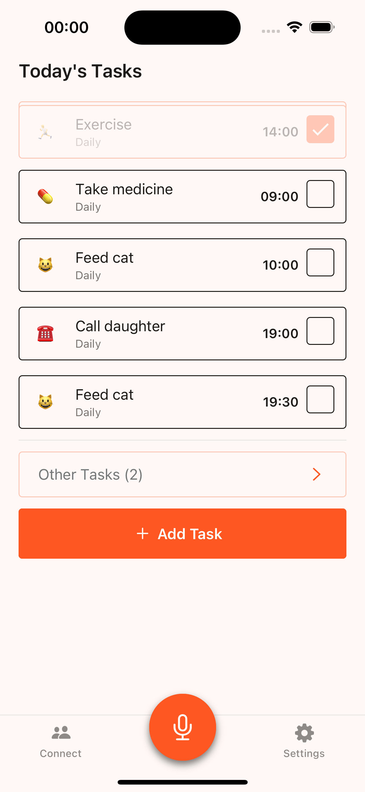
  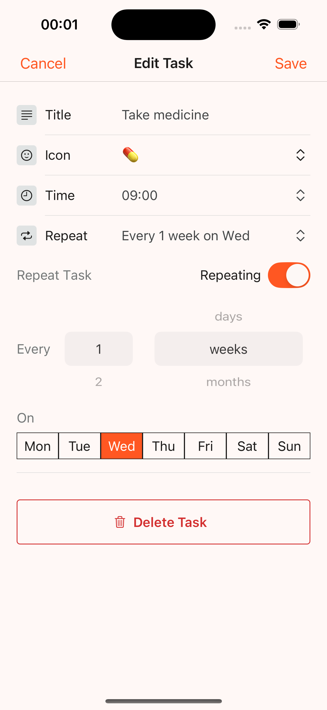
  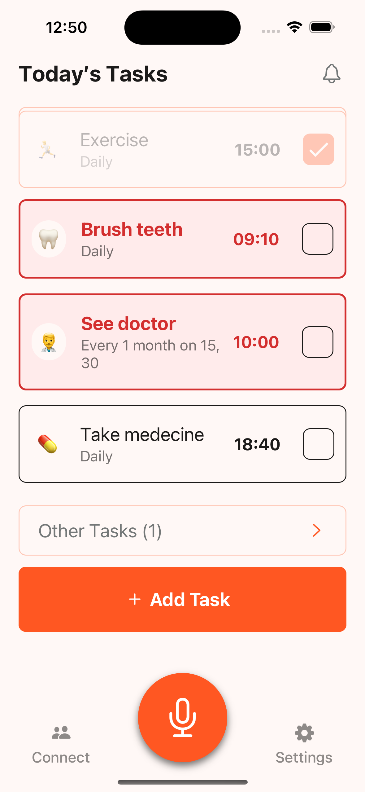
</p>

- Create, complete, update, and query tasks using voice or touch
- Recurring and time-based reminders
- AI assistant designed for accessibility

#### Voice Interaction

<p float="left">
  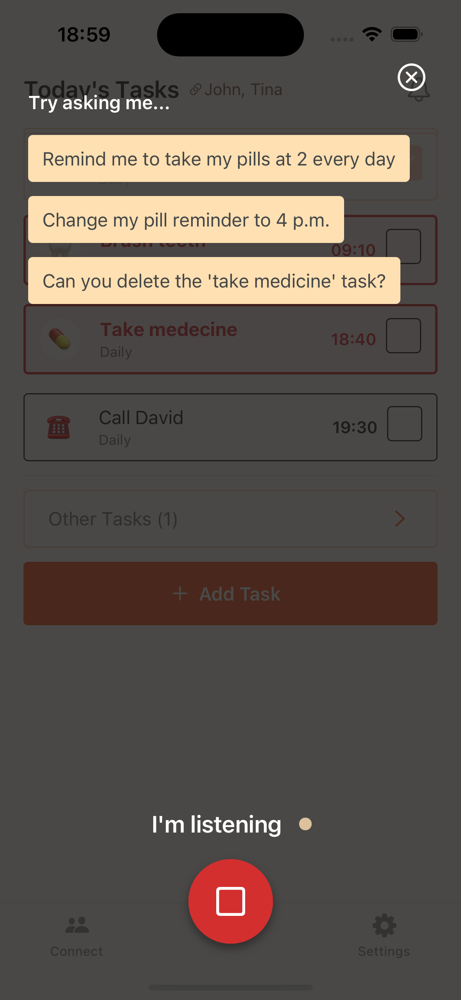
  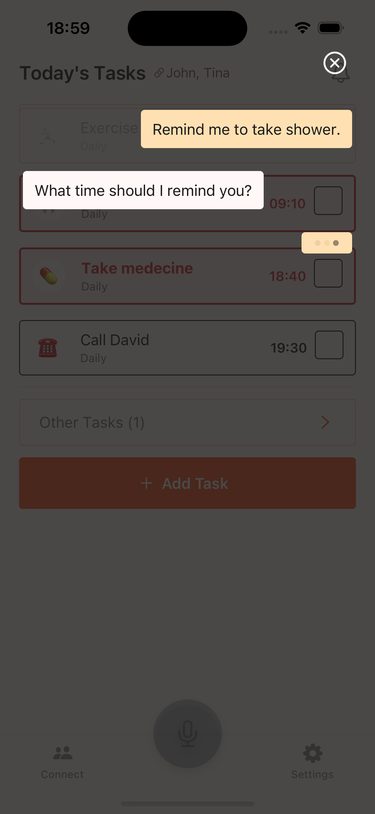
  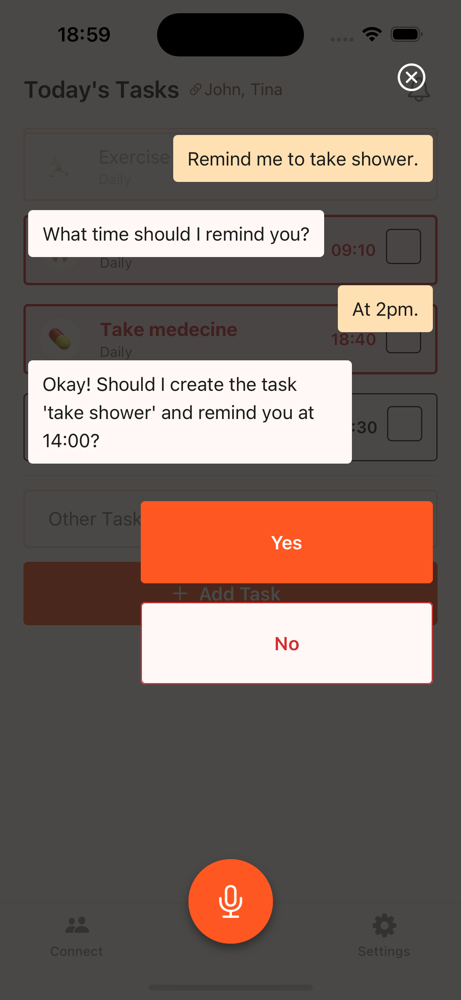
</p>

- AI assistant designed for accessibility
- Commands are processed by a backend API using speech-text and LLM-powered parsing

#### Caregiver Collaboration

<p float="left">
  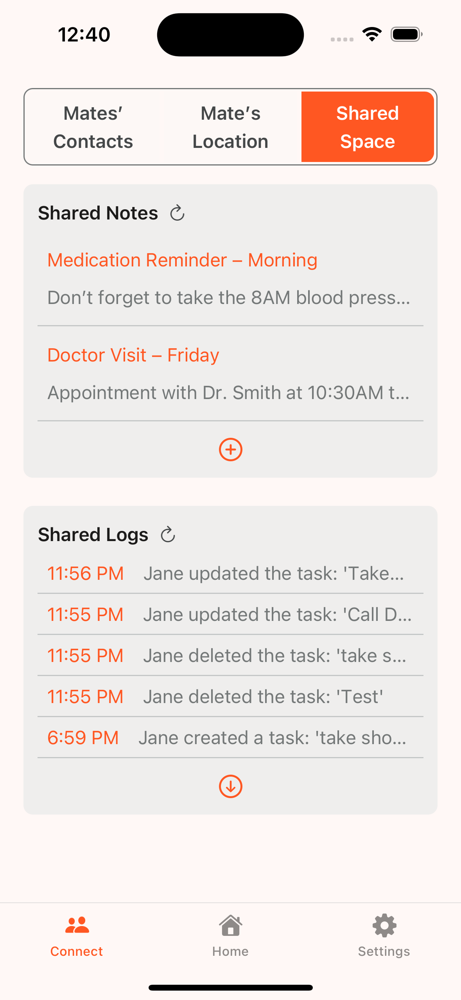
</p>

- Share notes and task logs among linked mates
- Visual indication of status, time, and updates

#### Location-aware Safe Zone Detection

<p float="left">
   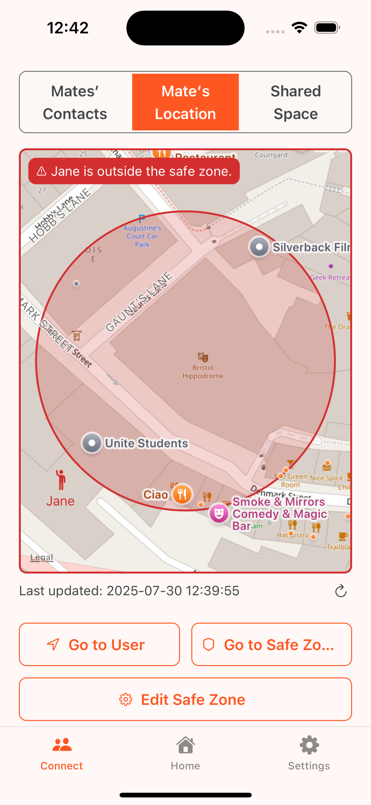
   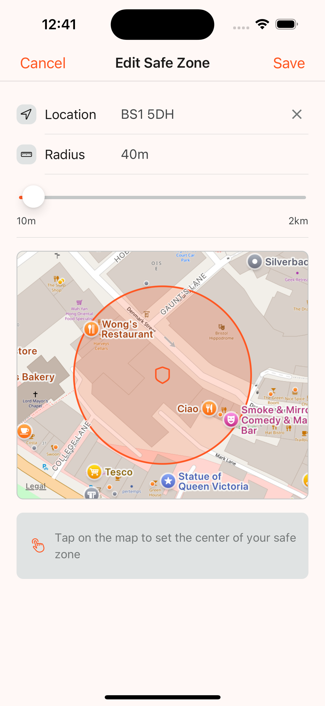
</p>

- Set a safe area using address + radius input
- Detect when the user is outside the zone via background geofencing

#### Emergency Contact

<p float="left">
   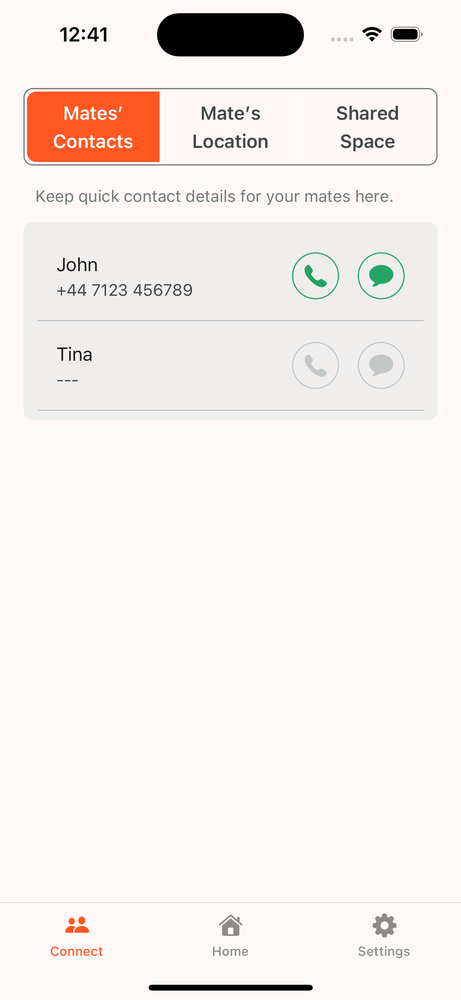
   
</p>

- Trigger emergency calls or WhatsApp to preset contacts
- Customizable list stored in user settings

#### Notification

<p float="left">
  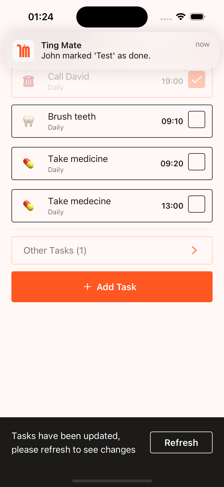
  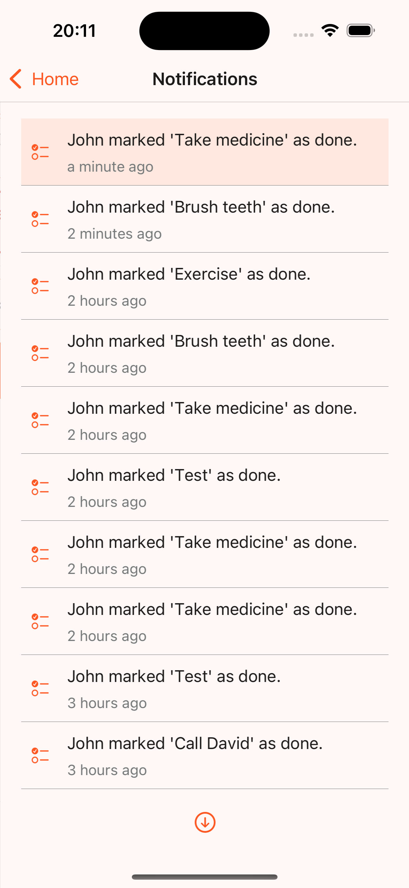
</p>

- Task reminders are delivered through scheduled local notifications, even when the app is closed.
- When the user is online, real-time updates (such as caregiver-triggered events) via SSEare pushed instantly through a live connection.

#### Account Modes, Onboarding, and Tutorial

<p float="left">
  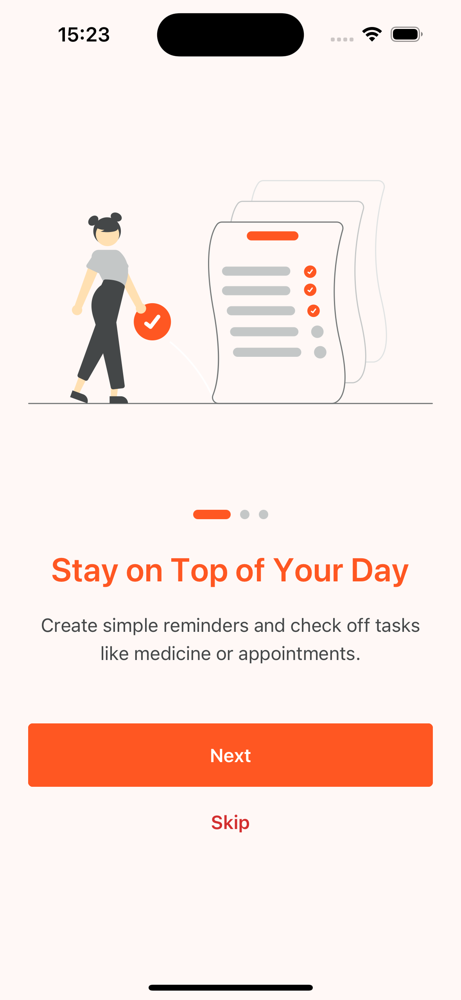
  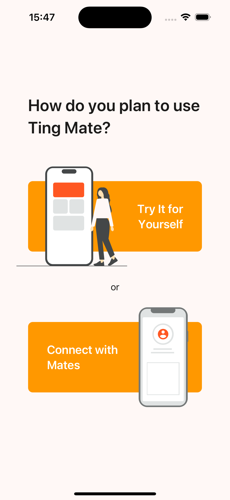
  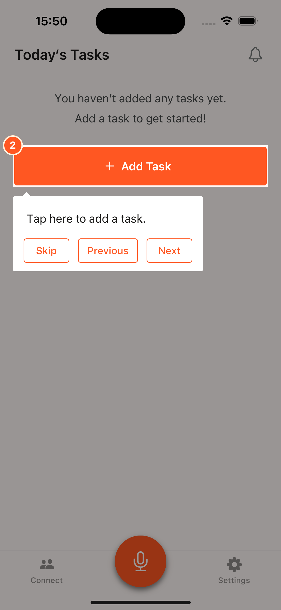
</p>

- Anonymous usage or linked account pairing
- First-time user tutorial with contextual walkthrough

### Future Work

- **Background Functionality**

  - Enable background location tracking for safe zone monitoring
  - Implement push notifications for real-time caregiver alerts when the app is closed

- **Voice Assistant Enhancements**

  - Improve accuracy for commands
  - Add support for casual conversations and non-task queries
  - Integrate iOS built-in speech-to-text for faster and more reliable recognition

- **Account Linking Improvements**

  - Support QR code–based linking for easier setup

- **Accessibility and Personalization**

  - Expand accessibility modes (e.g., larger text profiles, simplified layouts)
  - Add support for multiple languages

- **Home Screen Widget**
   <p float="left">
      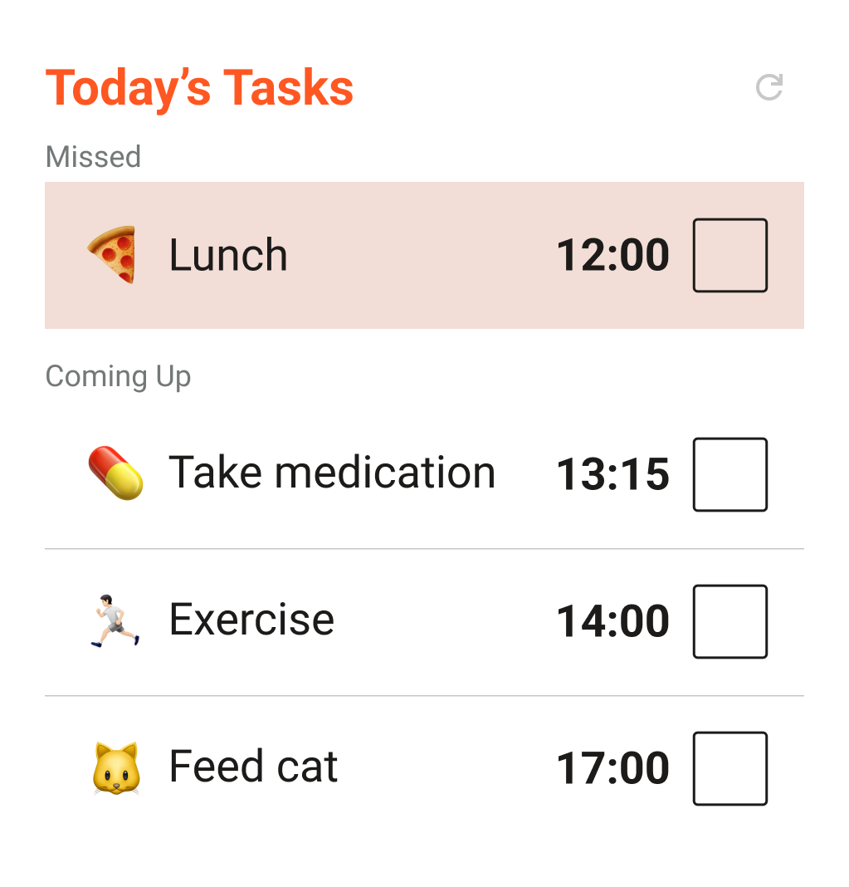
      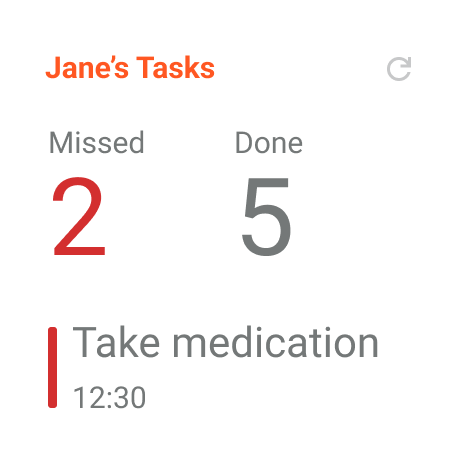
      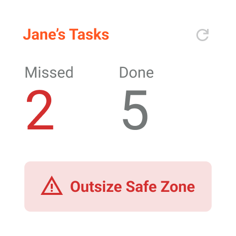
   </p>
   
  - Implement task and location widgets for quick access without opening the app

## Development Stack and Setup

### Project Structure

- `app`: Expo routing files for navigation (e.g., tabs for Home and Settings).
- `src/assets`: Fonts, images, and sound effects.
  - `sounds/`: Sound effect files downloaded from [Mixkit](https://mixkit.co/free-sound-effects/) for free use in commercial and personal projects.
- `src/components`: Reusable UI components, organized by Atomic Design (atoms, organisms) and screens (UI logic for each app page).
- `src/store`: State management (e.g., Redux, to be added later).
- `src/styles`: Global styles and themes (e.g., colors, typography).
- `src/hooks`: Custom hooks.
- `src/constants`: Constants for configuration.
- `src/types`: TypeScript type definitions.

### Get started

1. Install dependencies

   ```bash
   npm install
   ```

2. Start the app

   ```bash
   npx expo start
   ```

In the output, you'll find options to open the app in a

- [development build](https://docs.expo.dev/develop/development-builds/introduction/)
- [iOS simulator](https://docs.expo.dev/workflow/ios-simulator/)
- [Expo Go](https://expo.dev/go), a limited sandbox for trying out app development with Expo

### Packages and Tools Used

- React Native with Expo
- Expo Router (file-based navigation)
- React Native Paper (UI components)
- Zustand (state management)
- React Native Maps
- Expo Location and Task Manager
- Expo Notifications
- Linking API for phone and WhatsApp triggers
- TypeScript

### Additional Resources

- [Backend API Repository](https://vivi2393142.github.io/ting-mate-backend/)

  Contains the FastAPI backend for handling task data, user sessions, location tracking, and voice assistant integration.

- [AI-Based User Research and Evaluation](https://vivi2393142.github.io/ting-mate-ai-research/)

  This project includes a novel and deliberate use of AI personas and LLM-assisted simulations to conduct both requirement interviews and usability evaluations. This approach was designed to explore the feasibility of AI-assisted user research, particularly in contexts where access to real users (e.g., memory-impaired individuals) is limited.
